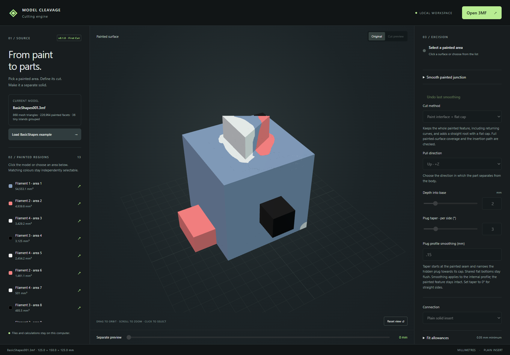

# Model Cleavage

**v0.1.0 — First Cut**

Turn painted regions of a single-mesh OrcaSlicer 3MF into separate solid parts and matching sockets for assembly after printing. Model Cleavage runs as a local web app: open a painted model, select a region, choose how it separates, and preview the cut before exporting.



This is an early working release. Geometry checks help catch invalid results, but practical fit and assembly still need inspection and print testing. See the [roadmap](ROADMAP.md) and [release notes](CHANGELOG.md).

## What First Cut can do

- Reconstruct Orca/Prusa TriangleSelector paint regions and select individual areas in a 3D viewer.
- Excise complete solid parts using an interface-following directional cut and a flat internal mating cap.
- Start adjustable plug taper at the three-dimensional paint seam, with internal profile smoothing and supported shared flat-bottom protection.
- Apply fit allowance to the body, the part, or half on each.
- Add an optional paired undercut glue-key recess; plain solid inserts are also supported.
- Inspect problem geometry, review and approve supported repairs, and save an approved repair as a new 3MF.
- Group nearby tiny same-colour paint islands and preview/apply/undo bounded paint-border smoothing.
- Run cuts in cancellable workers with progress stages.
- Export aligned multipart 3MF assemblies, cut settings and validation reports. Individual STLs are included when their precision checks pass.

Files and calculations stay on the computer running the app. Normal use needs no cloud service or internet connection; Three.js is bundled locally.

## Install and start

The supplied launchers target Windows. The tested geometry runtime is **Python 3.12**. Node.js is only needed for optional browser tests.

From a clone of this repository, create a Python environment and install the pinned packages:

```powershell
py -3.12 -m venv .venv
.\.venv\Scripts\python.exe -m pip install -r requirements.txt
New-Item -ItemType Directory -Path .runtime -Force
(Resolve-Path .\.venv\Scripts\python.exe).Path | Set-Content .runtime/python-path.txt
```

Double-click **Start Cutting Engine.cmd**. It opens [the local app](http://127.0.0.1:8765/). **Stop Cutting Engine.cmd** stops the server; closing the browser alone does not stop it. Run `.\Start.ps1 -NoBrowser` to start without opening another browser tab.

The Python server can also be started directly using the environment in which the requirements are installed:

```powershell
.\.venv\Scripts\python.exe server.py --port 8765
```

The service binds to loopback. Other operating systems have not been release-tested; the Windows launchers do not apply there. Dependency installation requires network access unless the packages are already available locally.

## Try the included example

Choose **Load BasicShapes example**, or open [examples/BasicShapes001.3mf](examples/BasicShapes001.3mf). This is the original painted single-mesh starter model, included to make the workflow reproducible. It is also retained as a regression fixture.

1. Select a painted area in the viewer or region list.
2. Choose the pull direction and depth into the base. The default depth is 2 mm; the selected protrusion remains a complete solid.
3. Adjust plug taper, internal profile smoothing and fit allowances. The alternate planar cutting mode exposes a base-plane control.
4. Choose **Preview cut**. Move **Separate preview** to inspect the plug and socket. Expand **Cut Check** to review validation and piece counts.
5. Choose **Save export**. The app saves a ZIP in `output/` and starts a browser download of the same bundle.

Changing the selection or cut settings invalidates the old preview and disables export until another preview succeeds. Exported assemblies contain multiple meshes and are intended for a slicer such as OrcaSlicer; the current input loader accepts single-mesh source projects.

### Fit allowances

Side clearance is **per side**, rather than a diameter adjustment. Zero means an effective minimum of **0.05 mm per side** and **0.05 mm axial depth clearance**. Larger values are used as entered.

- **Main body:** enlarge the socket.
- **Excised part:** reduce the mating plug, helping preserve socket walls.
- **Both:** split the allowance equally. At the minimum, each receives 0.025 mm.

For example, 0.2 mm side clearance adds 0.4 mm across a socket when assigned entirely to the body. At a curved seam, part-side allowance can trim points inside the configured seam band; these are reported separately from missing painted interior. Requested values, effective values and allocation are recorded in the export report.

## Current limits

- One mesh instance in millimetres, one excision per export, and six axis-aligned pull directions.
- The exported part and base have solid filament assignments. Other original paint regions on the remaining base are not preserved yet.
- Ball/socket and slide-fit connectors, multiple cuts, named parts, project save/load, selective export and section views are planned.
- Border smoothing adjusts existing mesh vertices; it is not an adaptive remeshing or sculpting tool.
- Cleanup is bounded. Some numerical skins and detached fragments can be corrected, but this is not a general minimum-wall-thickness guarantee. Invalid or unsuitable cuts can still be rejected.
- Closed solids and a checked directional withdrawal path do not establish real-world strength, adhesive retention, printer fit or print orientation. Inspect the mating surfaces before printing.

Original model files are not overwritten. An approved repair is applied to the working copy and can be saved separately.

## Development and verification

With the Python environment configured:

```powershell
.\.venv\Scripts\python.exe -m unittest discover -s tests -v
```

The release passed **63 Python tests** on the development installation, plus browser workflow checks and separate seven-degree ear/tail/foot and starter-feature checks. Private organic models and generated investigation files are not bundled. `tests/check_starter_regions.py` is a slower optional starter audit.

Optional browser tests need a running local server and Playwright:

```powershell
npm install
npx playwright install chromium
npm run test:browser
npm run test:layout
npm run test:seam
```

`MODEL_CLEAVAGE_BROWSER` can point to a browser executable. A private-model repair regression is skipped unless `MODEL_CLEAVAGE_REPAIR_SAMPLE` is set to its original test input; that model is not distributed. Browser checks operate on the app's active session, so run them when no user cut is in progress.

See [architecture](docs/architecture.md) for source layout and validation boundaries.

## Licence

Model Cleavage is distributed under [GPLv3](LICENSE). Bundled Three.js assets retain their [MIT licence notice](web/vendor/THREE-LICENSE.txt). Python dependencies retain their respective licences and are installed separately.
